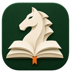
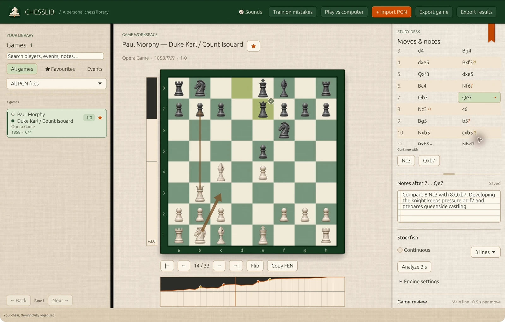
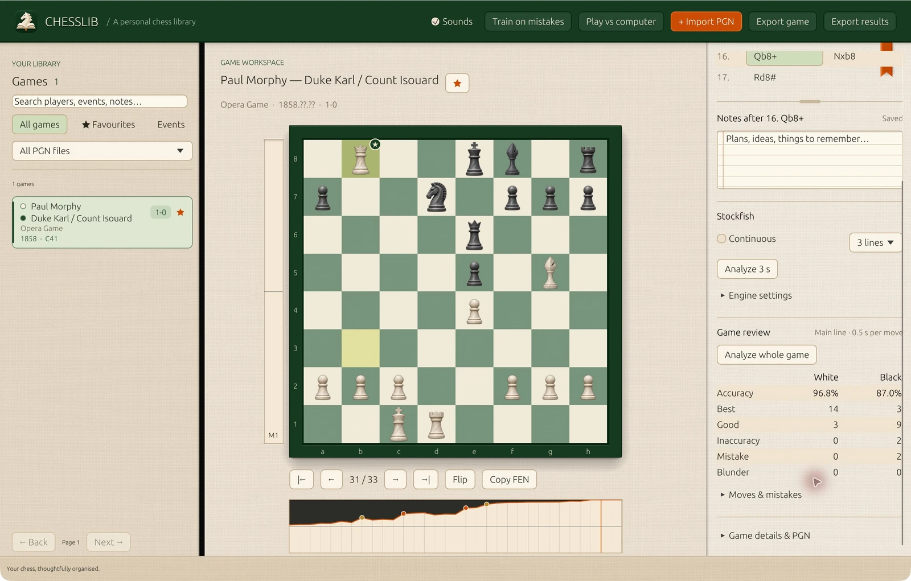
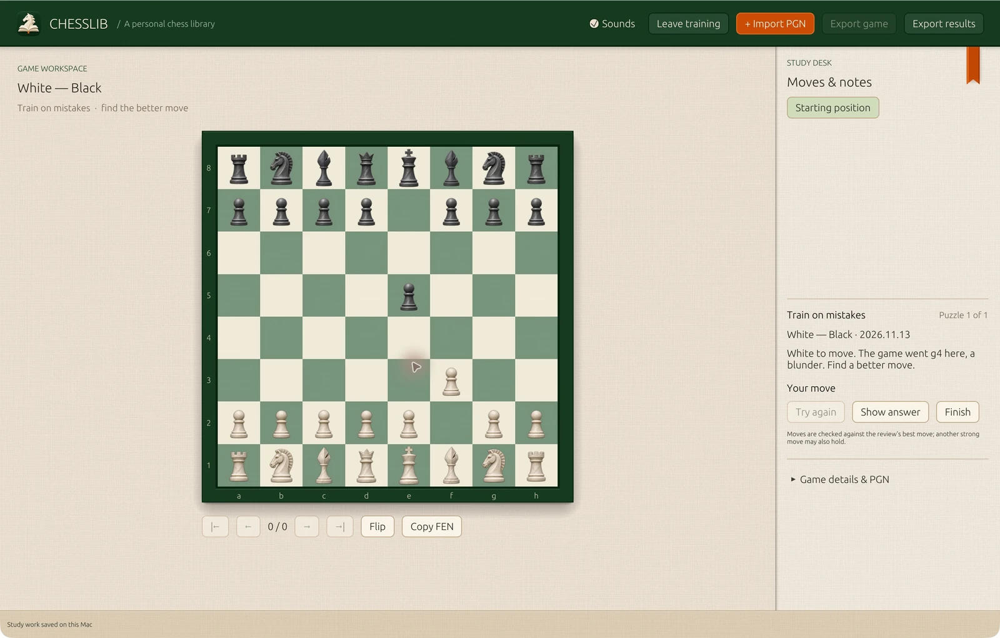

<p align="center">
  
</p>

<h1 align="center">ChessLib</h1>

<p align="center"><strong>A personal chess library for macOS</strong></p>

<p align="center">
  <a href="#quick-start">Quick start</a> ·
  <a href="#review-and-train">Review and train</a> ·
  <a href="#stockfish-setup">Stockfish setup</a> ·
  <a href="#library-and-study-guide">Study guide</a>
</p>

Import your PGNs, play through the positions that matter, and keep your notes alongside the moves. ChessLib stores your library on your Mac and runs Stockfish locally.

[](docs/screenshots/study.webp)

*The Opera Game at 7…Qe7. The arrows show two continuations you can play from this position.*

## Quick start

1. **Open ChessLib.** Open `dist/ChessLib.app` if you already have a local build. To create it from this checkout, run the command below and open the resulting app in Finder.

   ```sh
   sh scripts/bundle-macos.sh
   ```

2. **Add a game.** Choose **Try a sample game** to load the Opera Game, or use **Import PGN** (⌘O) to bring in your own files.
3. **Study a position.** Select a game, step through it with the arrow keys, then play an alternative on the board or jot down a note. Variations and notes save automatically.

The build script targets Apple Silicon. For development, run `cargo run --release --locked`. An Intel Mac needs an Intel Rust toolchain. The Intel build remains untested.

## What you can do

| Feature | What you can do |
| --- | --- |
| **Organize a collection** | Search players, events, ECO codes and notes. Browse by event, filter by source file or favourite, and export a game or the current results as PGN. |
| **Build your own study** | Play and revisit variations, mark moves with symbols such as `!` and `??`, draw arrows and circles, and save notes at any position. |
| **Analyze or play against Stockfish** | Run a three-second analysis or keep it running as you step through the game. Play the engine from the opening or from the position on the board. |
| **Practice from your games** | Review a game's main line, jump to flagged moves on the evaluation graph, and replay the positions where a player blundered. |

## Review and train

**Review a game.** Select **Analyze whole game** to estimate accuracy for both sides and flag inaccuracies, mistakes and blunders. Completed reviews are saved with the game.

[](docs/screenshots/review.webp)

**Try the position again.** Select **Train on mistakes** to play puzzles from reviewed blunders. Filter by player, or right-click a reviewed game and choose **Train on this game**.

[](docs/screenshots/training.webp)

## Stockfish setup

Install Stockfish separately to analyze, review, or play against the computer. ChessLib searches standard Homebrew locations, `/usr/bin`, and `PATH`. You can also open **Engine settings** and click **Choose Stockfish…** to select the executable for the current session or set `CHESSLIB_STOCKFISH=/absolute/path/stockfish` before launching.

ChessLib communicates with Stockfish over UCI and uses one engine thread and 64 MiB of hash memory. Library browsing and annotation work without an engine.

## Library and study guide

<details>
<summary>Importing, navigating and annotating games</summary>

- **Import PGN** or **⌘O** opens one or more files; dropping PGNs into the window also imports them, and **⌘V** outside a text field imports PGN text from the clipboard (listed under the source `chesslib-paste.pgn`). The sample button adds Morphy's Opera Game. After an import, each new game missing players, event or date asks for them; right-click any game and choose **Edit…** to change those fields later.
- Search players, event names, dates, ECO codes, imported comments, and your notes. Search is case-insensitive, matches word prefixes, and requires all entered words. It is not an arbitrary substring search.
- Browse by event or narrow the library by source PGN filename or favourites. Results are paged, newest imports first.
- Select a game, click a move, or use **← / →**, **↑ / ↓** or **Home / End**. Navigation follows the current line. Flip the board (**F**) or copy the current FEN. **L** toggles continuous analysis. Drag the rule under the move list to resize it.
- **Play a move:** click a piece, then a highlighted destination. Legal moves include castling (click the king's destination), en passant and a choice of all four promotion pieces. Escape clears the selection. Existing moves are reused; alternatives become saved variations.
- Playing or stepping forward one move uses recordings of pieces on a wooden board. Captures have a firmer clack. Turn off **Sounds** in the toolbar to mute them across launches. The CC0 recordings are by el_boss. [Piece Placement](https://freesound.org/people/el_boss/sounds/546119/) · [Piece Capture](https://freesound.org/people/el_boss/sounds/546120/)
- **Explore variations:** choose **Continue with** before a branch, or **Alternatives at this move** after it. **Return to main line** returns to the corresponding move in the main line. Imported variations are playable too. In the move list, a small **+N** after a move means it has N alternatives (hover to list them). Where the line branches, brown arrows on the board show every next move, the continuation bolder. Right-click a side-line move and choose **Promote variation** to make it the line's continuation (the moves played in the game always stay the main line), or **Delete from here** to remove a line you added, with everything after it and its notes, marks and drawings. Imported variations cannot be deleted.
- **Analyze 3 s** runs local Stockfish for the selected position, showing a White-relative evaluation, depth, best move and continuation. **Play best** explores its suggestion.
- **Play vs computer** starts a practice game from the current position, or from the starting position when no game is open. Choose a side and a Stockfish level from 0 to 20.
- The vertical evaluation bar beside the board shows White/Black advantage and the score. It follows board orientation, uses live analysis first and saved review scores otherwise, and shows a neutral dash when the position has no evaluation. Checkmate and drawn positions display their outcome.
- **Continuous** keeps Stockfish calculating until disabled. Changing positions cancels the previous calculation and starts a new one. The once button switches to a bounded calculation; Stop disables continuous mode. Closing the app stops and reaps the engine.
- **Analyze whole game** reviews the original main line at 0.5 seconds per position, with progress and cancellation. The report shows approximate accuracy for each side, best/good moves, inaccuracies, mistakes and blunders. Expand **Moves & mistakes** to jump to a move; hover for its suggested continuation. Completed reports autosave with the game and survive reopening. Cancelled runs retain any previous completed report. Continuous analysis pauses during a review and resumes afterward.
- **Train on mistakes** turns every blunder (a loss of at least 20 win-chance points) from all reviewed games into a puzzle: the board shows the position before the move, and you look for a better one. Enter a player name to train only on that player's moves, or right-click a game and choose **Train on this game** for both sides' blunders in that game alone. A move counts as correct when it matches the review's suggested move, so another strong move may be marked as different. **Show answer** reveals the engine line. Training never changes the saved games.
- **Mark a move:** right-click it in the move list and choose !!, !, !?, ?!, ? or ??. Marks from imported PGNs show too, and after **Analyze whole game** its inaccuracies, mistakes and blunders appear as ?!, ? and ??. Your own mark replaces either; review marks are not exported.
- **Draw on the board:** right-drag for an arrow, right-click a square for a circle; hold Shift, Option or both for red, blue or yellow. Drawing a shape again removes it. Drawings are saved with each move, and each game remembers whether you flipped its board.
- Write notes at the starting position or after any move, including variations. Notes autosave after a short pause, before changing games, and before closing. **⌘S** saves immediately. If saving fails, edits remain open and closing is blocked.
- **Export game** writes the selected game. **Export results** writes every game matching the current filters, across all pages. Both include your notes, original annotations, NAGs, imported variations and newly added lines.
- Imports run in the background. **Stop** retains completed work. Reimporting the same parsed game skips it without overwriting notes.

</details>

<details>
<summary>How review scoring works</summary>

Reviews use the [published Lichess move-accuracy equations](https://lichess.org/page/accuracy): convert White's centipawn score to `100 / (1 + exp(-0.00368208 * cp))`, then measure the mover's loss in that value. Mate and terminal outcomes map to 0/100, or 50 for a draw. Move accuracy is `103.1668 * exp(-0.04354 * loss) - 3.1669`, clamped to 0–100 (no loss = 100).

ChessLib reports **approximate accuracy** as the arithmetic mean of that side's move accuracies. Losses of at least 5, 10 and 20 percentage points are classified as inaccuracy, mistake and blunder. Other moves are Best if they match the engine's suggestion, otherwise Good. Scores vary with search time. The review sends the entire move history to Stockfish so repetition context is available. Resignation results are not treated as a forced mate in the final position.

</details>

<details>
<summary>Local storage, backups and large collections</summary>

The default database is `~/Library/Application Support/ChessLib/library.sqlite3`. `CHESSLIB_DB=/absolute/path/library.sqlite3` overrides it for development or a separate library.

PGN input is streamed one game at a time. SQLite commits batches of 200 games, uses WAL, and indexes full-text search with FTS5. The GUI holds 80 result rows and the selected game; it does not load the entire library. Pagination uses an ID cursor instead of increasingly expensive offsets. Search, imports, loading, and export run off the UI thread. Note writes are synchronous and may briefly wait for an import transaction.

Original PGN files are never changed during import. Imported tags and move tokens also remain unchanged in storage when studying: added moves are saved separately inside the game's record. Existing main-line note indices remain valid, and added/imported branch notes use stable node IDs. Reimporting the original PGN still skips it without removing study work. Use this version or newer for libraries with added variations; older builds do not understand that study data. Games are stored as parsed tags and tokens; export normalizes formatting rather than reproducing original bytes. A duplicate means identical parsed content, not merely the same moves. Files with the same basename share a source filter; duplicate games remain under their first source.

For a complete backup, quit the app and copy the database. While the app is running, SQLite may also use `-wal` and `-shm` sidecars; copying only the main file at that time is not a reliable backup. PGN export is portable but does not preserve favourites or source grouping.

</details>

<details>
<summary>Supported PGNs and current limits</summary>

- Standard chess and legal FEN starting positions. Unsupported variants remain stored and exportable, with a display error. An illegal imported move disables that continuation with an explanation; other legal branches remain playable and the original tokens survive export.
- Variations can be added, explored, promoted and (if you added them) deleted, with notes on each position. Deleting imported variations, replacing the game's own moves as the main line, and editing imported annotations are not included.
- No opening tree, online sync, position search, or collection deletion. The game editor covers White, Black, Event and Date only. Position analysis supports one-shot and continuous modes. Full-game review covers the original main line; it does not classify study variations.
- Notes are separate from original annotations. On export, braces in comments are replaced with parentheses because PGN brace comments cannot nest.
- UTF-8 PGNs are supported; invalid byte sequences are replaced by the Unicode replacement character. Very long comments may be normalized into multiple comments. A single game is capped at 16 MiB of parsed content to bound accidental memory growth. Malformed PGNs should be checked against their originals; the PGN reader is permissive.
- The build script signs the app ad hoc for local use.

</details>

## Development

ChessLib is built with Rust, eframe/egui, pgn-reader, shakmaty, and bundled SQLite. See the [design notes](docs/design.md) for the visual system.

<details>
<summary>Tests and the 100,000-game benchmark</summary>

```sh
cargo test --locked
cargo clippy --all-targets --locked -- -D warnings
cargo test --release --locked -- --ignored --nocapture
```

The ignored library test generates 100,000 distinct 33-ply games, imports them into a temporary database, checks first/deep pages and indexed search, saves a note, exports a game, verifies SQLite integrity, and reports timings. Its temporary files are removed afterward.

Measured on the development Mac (Apple Silicon, release build, 12 November 2026): 100,000 games imported in **7.61 s**, first page **254 ms**, indexed player search **11 ms**, deep page **42 ms**. This is one synthetic local run, not a guarantee for arbitrary PGNs or multi-million-game databases.

</details>

## License

[GPL-3.0-or-later](LICENSE).
